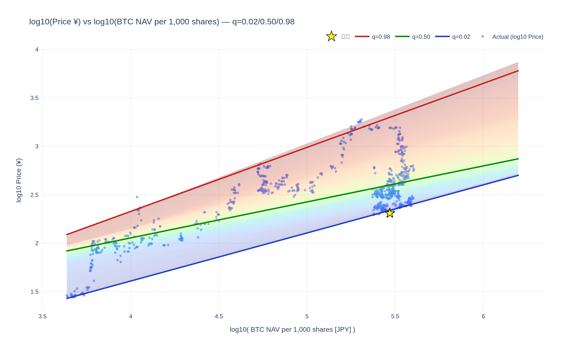
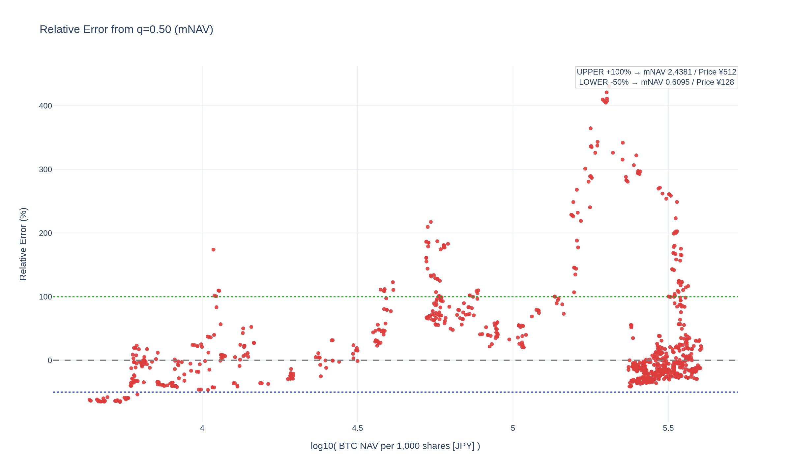

# meta-analysis

<!--REPORT:START-->
**Last update (JST):** 2026-11-24 04:39 (UTC+09:00)

**Historical data through:** 2026-11-23

### Summary
・Bitcoin価格: $61,334［2026-11-23・公式データ］（¥9,751,529［2026-11-23・公式データ］）  
・株価: ¥177［2026-11-23・公式データ］（mNAV=1: ¥221）

### Signals
・RSI(週足,14)（暫定）: 30.6  
・乖離率 (mNAV vs q=0.50): -33%  
・Signal: 🔵 買い  
｜買いライン(q=0.05/0.03/0.02): ¥178 / ¥175 / ¥174  
｜売りライン(q=0.95/0.97/0.98): ¥1,066 / ¥1,146 / ¥1,246

| Method                 | 0.01   | 0.02   | 0.03   | 0.05   | 0.10   | 0.20   | 0.30   | 0.40   | 0.50   | 0.60   | 0.70   | 0.80   | 0.90   | 0.95   | 0.97   | 0.98   | 0.99   |
|:-----------------------|:-------|:-------|:-------|:-------|:-------|:-------|:-------|:-------|:-------|:-------|:-------|:-------|:-------|:-------|:-------|:-------|:-------|
| mNAV Regression        | ¥171   | ¥174   | ¥175   | ¥178   | ¥185   | ¥206   | ¥220   | ¥238   | ¥265   | ¥313   | ¥399   | ¥537   | ¥772   | ¥1,066 | ¥1,146 | ¥1,246 | ¥1,398 |
| Stock-Price Regression | ¥198   | ¥210   | ¥212   | ¥216   | ¥226   | ¥254   | ¥312   | ¥341   | ¥387   | ¥475   | ¥621   | ¥830   | ¥1,200 | ¥1,657 | ¥1,769 | ¥1,918 | ¥2,200 |

### Charts
[Open interactive Chart 1: mNAV vs log10(NAV/1000) [JPY]](https://tkzm240.github.io/meta-analysis/fig1.html)

[Open interactive Chart 2: log10(Price) vs log10(NAV/1000) [JPY]](https://tkzm240.github.io/meta-analysis/fig2.html)

[Open interactive Chart 3: Relative Error from q=0.50 (mNAV)](https://tkzm240.github.io/meta-analysis/fig3.html)

[Open interactive Chart 4: Relative Error from q=0.50 (Price)](https://tkzm240.github.io/meta-analysis/fig4.html)

<!--REPORT:END-->
