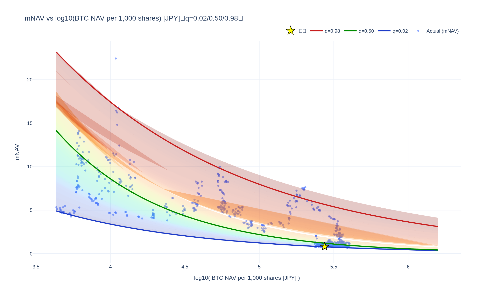

# meta-analysis

<!--REPORT:START-->
**Last update (JST):** 2026-11-18 02:13 (UTC+09:00)

**Historical data through:** 2026-11-17

### Summary
・Bitcoin価格: $63,650［2026-11-17・公式データ］（¥10,137,779［2026-11-17・公式データ］）  
・株価: ¥197［2026-11-17・公式データ］（mNAV=1: ¥238）

### Signals
・RSI(週足,14)（暫定）: 47.0  
・乖離率 (mNAV vs q=0.50): -30%  
・Signal: 🔵 買い  
｜買いライン(q=0.05/0.03/0.02): ¥189 / ¥186 / ¥185  
｜売りライン(q=0.95/0.97/0.98): ¥1,134 / ¥1,218 / ¥1,325

| Method                 | 0.01   | 0.02   | 0.03   | 0.05   | 0.10   | 0.20   | 0.30   | 0.40   | 0.50   | 0.60   | 0.70   | 0.80   | 0.90   | 0.95   | 0.97   | 0.98   | 0.99   |
|:-----------------------|:-------|:-------|:-------|:-------|:-------|:-------|:-------|:-------|:-------|:-------|:-------|:-------|:-------|:-------|:-------|:-------|:-------|
| mNAV Regression        | ¥182   | ¥185   | ¥186   | ¥189   | ¥197   | ¥220   | ¥233   | ¥252   | ¥280   | ¥331   | ¥428   | ¥571   | ¥873   | ¥1,134 | ¥1,218 | ¥1,325 | ¥1,489 |
| Stock-Price Regression | ¥213   | ¥216   | ¥218   | ¥222   | ¥231   | ¥259   | ¥318   | ¥349   | ¥396   | ¥486   | ¥648   | ¥850   | ¥1,229 | ¥1,699 | ¥1,825 | ¥1,968 | ¥2,261 |

### Charts
[Open interactive Chart 1: mNAV vs log10(NAV/1000) [JPY]](https://tkzm240.github.io/meta-analysis/fig1.html)

[Open interactive Chart 2: log10(Price) vs log10(NAV/1000) [JPY]](https://tkzm240.github.io/meta-analysis/fig2.html)

[Open interactive Chart 3: Relative Error from q=0.50 (mNAV)](https://tkzm240.github.io/meta-analysis/fig3.html)

[Open interactive Chart 4: Relative Error from q=0.50 (Price)](https://tkzm240.github.io/meta-analysis/fig4.html)

<!--REPORT:END-->
