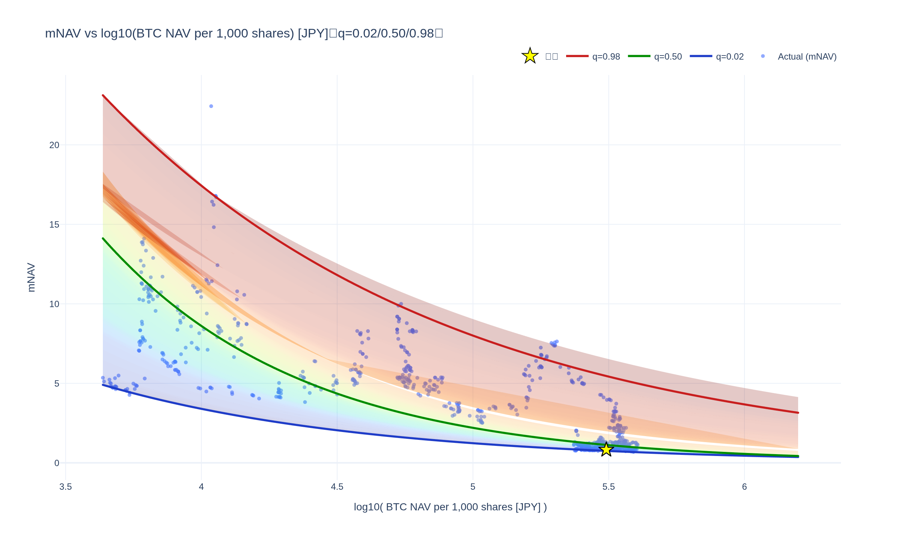
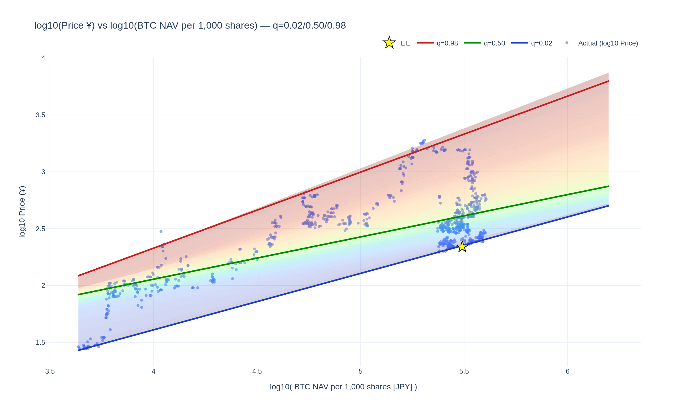
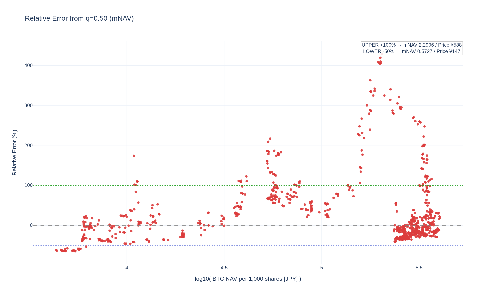
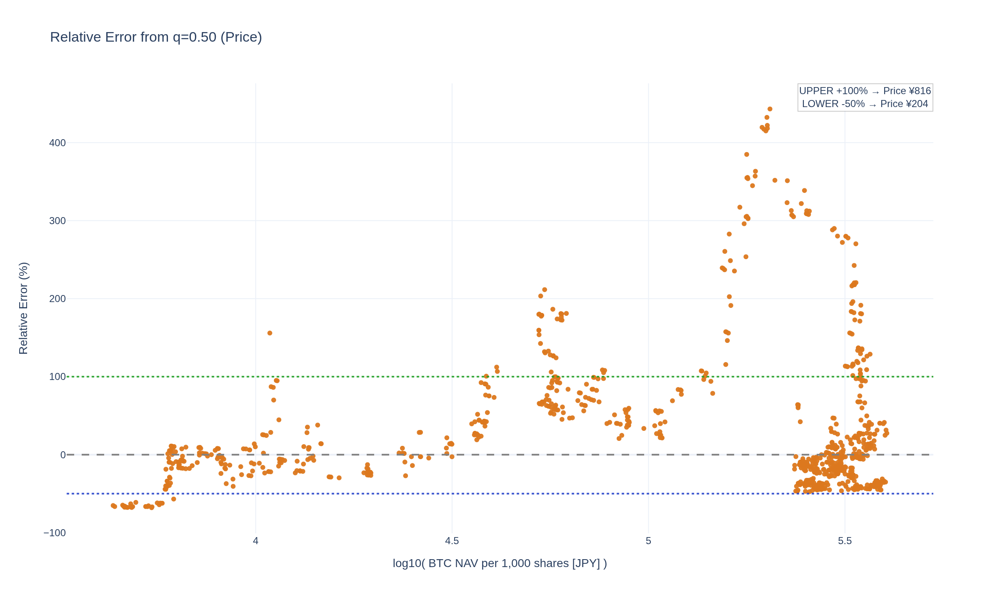

# meta-analysis

<!--REPORT:START-->
**Last update (JST):** 2026-11-14 16:20 (UTC+09:00)

**Historical data through:** 2026-11-13

### Summary
・Bitcoin価格: $67,308［2026-11-14・公式データ］（¥10,752,029［2026-11-14・公式データ］）  
・株価: ¥219［2026-11-14・公式データ］（mNAV=1: ¥266）

### Signals
・RSI(週足,14): 49.9  
・乖離率 (mNAV vs q=0.50): -27%  
・Signal: 🔵 買い  
｜買いライン(q=0.05/0.03/0.02): ¥205 / ¥201 / ¥200  
｜売りライン(q=0.95/0.97/0.98): ¥1,237 / ¥1,328 / ¥1,454

| Method                 | 0.01   | 0.02   | 0.03   | 0.05   | 0.10   | 0.20   | 0.30   | 0.40   | 0.50   | 0.60   | 0.70   | 0.80   | 0.90   | 0.95   | 0.97   | 0.98   | 0.99   |
|:-----------------------|:-------|:-------|:-------|:-------|:-------|:-------|:-------|:-------|:-------|:-------|:-------|:-------|:-------|:-------|:-------|:-------|:-------|
| mNAV Regression        | ¥197   | ¥200   | ¥201   | ¥205   | ¥214   | ¥238   | ¥253   | ¥272   | ¥300   | ¥356   | ¥461   | ¥619   | ¥951   | ¥1,237 | ¥1,328 | ¥1,454 | ¥1,630 |
| Stock-Price Regression | ¥223   | ¥224   | ¥227   | ¥232   | ¥241   | ¥268   | ¥327   | ¥359   | ¥408   | ¥504   | ¥670   | ¥884   | ¥1,369 | ¥1,782 | ¥1,910 | ¥2,117 | ¥2,375 |

### Charts
[Open interactive Chart 1: mNAV vs log10(NAV/1000) [JPY]](https://tkzm240.github.io/meta-analysis/fig1.html)

[Open interactive Chart 2: log10(Price) vs log10(NAV/1000) [JPY]](https://tkzm240.github.io/meta-analysis/fig2.html)

[Open interactive Chart 3: Relative Error from q=0.50 (mNAV)](https://tkzm240.github.io/meta-analysis/fig3.html)

[Open interactive Chart 4: Relative Error from q=0.50 (Price)](https://tkzm240.github.io/meta-analysis/fig4.html)

<!--REPORT:END-->
