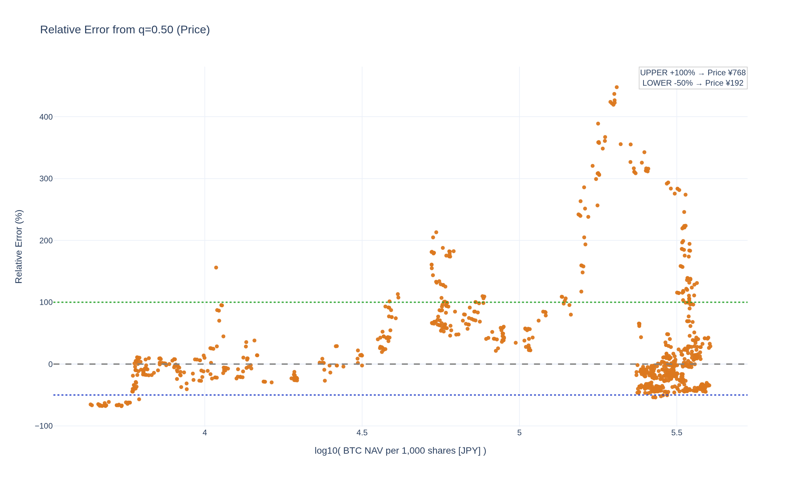

# meta-analysis

<!--REPORT:START-->
**Last update (JST):** 2026-11-28 17:40 (UTC+09:00)

**Historical data through:** 2026-11-27

### Summary
・Bitcoin価格: $59,614［2026-11-28・公式データ］（¥9,515,358［2026-11-28・公式データ］）  
・株価: ¥183［2026-11-28・公式データ］（mNAV=1: ¥218）

### Signals
・RSI(週足,14): 31.9  
・乖離率 (mNAV vs q=0.50): -31%  
・Signal: 🔵 買い  
｜買いライン(q=0.05/0.03/0.02): ¥177 / ¥174 / ¥173  
｜売りライン(q=0.95/0.97/0.98): ¥1,059 / ¥1,129 / ¥1,238

| Method                 | 0.01   | 0.02   | 0.03   | 0.05   | 0.10   | 0.20   | 0.30   | 0.40   | 0.50   | 0.60   | 0.70   | 0.80   | 0.90   | 0.95   | 0.97   | 0.98   | 0.99   |
|:-----------------------|:-------|:-------|:-------|:-------|:-------|:-------|:-------|:-------|:-------|:-------|:-------|:-------|:-------|:-------|:-------|:-------|:-------|
| mNAV Regression        | ¥171   | ¥173   | ¥174   | ¥177   | ¥184   | ¥205   | ¥220   | ¥238   | ¥265   | ¥312   | ¥392   | ¥534   | ¥768   | ¥1,059 | ¥1,129 | ¥1,238 | ¥1,388 |
| Stock-Price Regression | ¥183   | ¥205   | ¥209   | ¥212   | ¥223   | ¥249   | ¥308   | ¥336   | ¥383   | ¥469   | ¥607   | ¥814   | ¥1,179 | ¥1,629 | ¥1,739 | ¥1,885 | ¥2,159 |

### Charts
[Open interactive Chart 1: mNAV vs log10(NAV/1000) [JPY]](https://tkzm240.github.io/meta-analysis/fig1.html)

[Open interactive Chart 2: log10(Price) vs log10(NAV/1000) [JPY]](https://tkzm240.github.io/meta-analysis/fig2.html)

[Open interactive Chart 3: Relative Error from q=0.50 (mNAV)](https://tkzm240.github.io/meta-analysis/fig3.html)

[Open interactive Chart 4: Relative Error from q=0.50 (Price)](https://tkzm240.github.io/meta-analysis/fig4.html)

<!--REPORT:END-->
